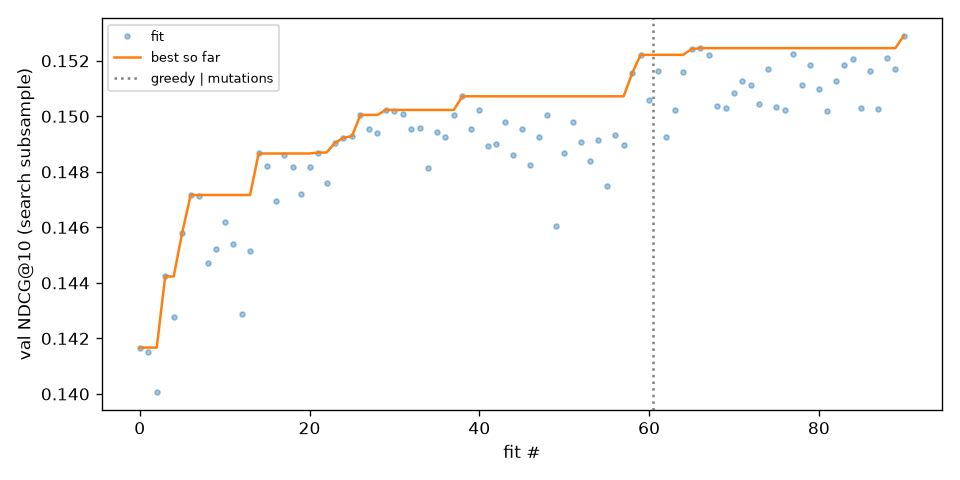
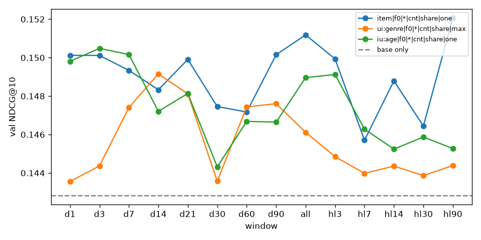
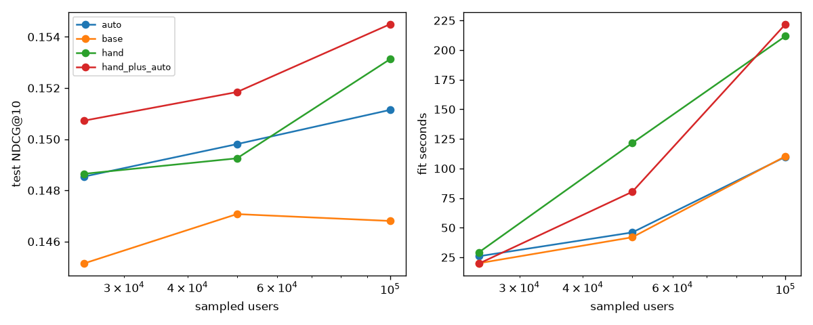

# Автоматический поиск признаков против ручного бустинга (KION)

Можно ли заменить ручной feature engineering в ранжировании рекомендаций автоматическим поиском по пространству агрегатов
(«связь × фильтр × окно × агрегация × нормировка»)? Здесь — воспроизводимый пайплайн на датасете KION (МТС): сильный
бейзлайн CatBoost на ручных признаках, AutoFE‑поиск по грамматике из 9 476 SQL‑признаков и сравнение на одинаковых
кандидатах, разбиении и гиперпараметрах.

## Коротко

На 100k пользователей (11 484 тестовых), test NDCG@10:

| модель | признаков сверх base | test NDCG@10 |
|---|---|---|
| Popular‑7d | — | 0.1297 |
| CatBoost, только base (скоры генераторов + статические атрибуты) | 0 | 0.1468 |
| **Hand** — ручной набор | 35 | 0.1531 |
| **Auto** — найден поиском | 9 | 0.1511 |
| **Random** — 35 случайных из той же грамматики (3 выборки) | 35 | 0.1519 |
| **Hand ∪ Auto** | 44 | **0.1545** |

- Ручной набор дал +0.0063 к base. Поиск с 9 признаками даёт ~70 % этого прироста (+0.0043) и считается в 3.5 раза
  быстрее, но на 100k статистически уступает Hand (−0.0020, 95 % CI [−0.0035; −0.0002]). На 25k и 50k Auto ≈ Hand.
- **Лучшее — объединение**: Hand ∪ Auto выше Hand на всех масштабах; значимо на 50k и 100k (+0.0014 на 100k,
  CI [+0.0004; +0.0024]).
  Поиск нашёл сигналы, которых у человека не было: «свежесть» item за 14 дней стала самым важным признаком итоговой модели.
- **Главный и неожиданный вывод — контроль Random**: 35 случайных признаков из грамматики не хуже ручных
  (−0.0013, CI [−0.0027; +0.0002]) и не хуже Auto. Основную ценность дала **сама грамматика** (косвенные связи и
  популярность внутри демографической группы), а не умный отбор. Отбор на шумной валидации в основном решил, сколько
  признаков достаточно.
- «Почему 7 дней?» Универсального ответа нет. Для предпочтений по жанру явный оптимум — 14 дней: test 0.1480 против
  0.1397 у окна «вся история», которое выбрал я в Hand. Для популярности item кривая немонотонная, и окно, лучшее на val,
  не совпадает с лучшим на test.

## 1. Данные и постановка

**KION**: 5.48 млн просмотров, 962 тыс. пользователей, 15.7 тыс. фильмов и сериалов, 2021‑03‑13…2021‑08‑22.
`interactions(user_id, item_id, last_watch_dt, total_dur, watched_pct)`, `users(age, income, sex, kids_flg)`,
`items(content_type, genres, actors, directors, studios, countries, release_year, age_rating, for_kids, …)`.

Особенности, которые определяют дизайн:
- **Пара user–item встречается ровно один раз** (дата последнего просмотра + суммарная длительность). Повторного
  потребления в данных нет, поэтому прямые признаки пары («сколько раз смотрел этот item») вырождаются, а просмотренное
  исключается из кандидатов. Вся персонализация идёт через **косвенные связи**: жанры, актёры, режиссёры, студии,
  страны, тип контента, декада, возрастной рейтинг и демография.
- Тип события один — просмотр, его силу задаёт `watched_pct`. Поэтому в грамматике есть фильтр `watched_pct ≥ p`.
- Сильный тренд на новинки: популярность за последние дни — очень сильный сигнал.

**Задача**: для пользователя с историей предсказать, что он посмотрит в следующие 7 дней (метка = любое взаимодействие
в целевой неделе). Ранжируем кандидатов и считаем NDCG@10, Recall@10, MAP@10 **относительно всех** просмотров
пользователя в целевой неделе, включая не попавшие в кандидаты. Дополнительно — ROC‑AUC и LogLoss на парах.

**Сэмплирование**: случайные N пользователей **со всей их историей** (`--n-users`, сид фиксирован). Основной прогон —
100k пользователей (570k событий); масштабирование — 25k и 50k.

### Разбиение по времени

| фолд | история (признаки, кандидаты) | метки |
|---|---|---|
| train3 | < 2021‑07‑19 | [07‑19, 07‑26) |
| train2 | < 2021‑07‑26 | [07‑26, 08‑02) |
| train | < 2021‑08‑02 | [08‑02, 08‑09) |
| val | < 2021‑08‑09 | [08‑09, 08‑16) |
| test | < 2021‑08‑16 | [08‑16, 08‑23) |

Ранкер учится на трёх train‑неделях; у каждой недели свой срез, кандидаты, признаки и метки, а запрос YetiRank — пара
(неделя, пользователь). Early stopping, выбор признаков и окон делаются **только по val**; test используется для
итоговых чисел. Оцениваем «тёплых» пользователей (есть история до среза и есть метка). Холодным отдаём Popular‑7d:
NDCG@10 = 0.249 на 5 821 холодном пользователе test на 100k.

### Почему нет утечек
1. Каждый признак — SQL‑запрос с `WHERE dt < cutoff`; окна отсчитываются назад от среза.
2. Кандидаты (ItemKNN и популярность) строятся только по истории до среза. Item, впервые появившийся после среза,
   кандидатом стать не может.
3. Метка и её `total_dur`/`watched_pct` в признаки не попадают.
4. `tests/test_leakage.py` проверяет это механически на синтетике. К данным добавляются тысячи «будущих» событий,
   включая новые items, и кандидаты вместе со **всеми** проверяемыми признаками (ручные + 400 случайных из грамматики)
   не меняются. Там же SQL сверяется с прямым расчётом на pandas, а поиск проверяется на возобновление с чекпоинта.
   Если заменить `dt < cutoff` на `dt <= cutoff`, тест падает.
5. Известное ограничение самих данных: строка хранит только дату **последнего** просмотра. Если пользователь начал
   смотреть до среза, а досмотрел после, событие целиком попадает в метку и не видно в истории. Задача от этого чуть
   сложнее, но утечки нет.

## 2. Пайплайн

```
events ──► кандидаты (ItemKNN top‑100 ∪ популярное 7д/30д top‑50, без просмотренного; одинаковые для всех моделей)
       ──► base‑признаки (статические атрибуты user/item + скоры и ранги генераторов)
       ──► + набор агрегатов (Hand / Auto / Random)  ──► CatBoost (Logloss; YetiRank как вариант)  ──► top‑10
```

- **Кандидаты**: ItemKNN (косинус по бинарной матрице user×item, 100 соседей на item) top‑100 + популярное за 7 и 30
  дней top‑50, просмотренное исключено. ~140 кандидатов на пользователя. Recall кандидатов на test — 0.46: это потолок
  любого ранкера.
- **Base** (общие для всех моделей, 12 штук): age, income, sex, kids_flg, content_type, age_rating, for_kids (как
  `cat_features` CatBoost), release_year, knn_score, knn_rank, pop7_rank, pop30_rank.
- **CatBoost**: depth 6, lr 0.1, до 1000 деревьев, early stopping 50 по val, одинаковые гиперпараметры для всех наборов
  признаков. Основные модели — 2 сида, абляции и контроли — 1 сид. Обучение на Colab T4 (`task_type=GPU`).

### Ручной набор (Hand, 35 признаков)
Писал «как обычно пишут»:
- **пользователь**: активность за 7/30/all дней, средний watched_pct, давность последнего просмотра, стаж;
- **item**: популярность за 7/14/30/all, доля в популярности, досмотры, свежесть, тренд pop7/pop30, «возраст» на
  платформе;
- **пара**: доля жанра/страны/студии/типа контента/рейтинга/декады в истории пользователя, просмотры с теми же
  актёрами и режиссёром, lift жанра;
- **демография**: популярность item внутри возрастной, гендерной и доходной группы и группы «с детьми»;
- разница года выпуска с типичным для пользователя.

Полный список — `HAND` в `src/features.py`.

### Грамматика признаков (Auto)
Признак = `ключ | фильтр | окно | агрегация | нормировка | свёртка`; каждый компилируется в SQL‑запрос DuckDB:

| измерение | значения |
|---|---|
| ключ (связь) | `user`, `item`, `ui:<атрибут item>` — история пользователя по значению атрибута (genre, actor, director, studio, country, content_type, age_rating, decade), `iu:<атрибут user>` — история item внутри группы пользователя (age, income, sex, kids_flg) |
| фильтр | все события / `watched_pct ≥ 10 / 50 / 90` |
| окно | 1, 3, 7, 14, 21, 30, 60, 90 дней, вся история, экспоненциальное затухание с полупериодом 3/7/14/30/90 дней |
| агрегация | `cnt` (число просмотров), `dur` (время), `pct` (средний watched_pct), `rec` (1/дней с последнего) |
| нормировка | `raw`, `share` (доля от итога пользователя или группы), `lift` (доля / глобальная доля) |
| свёртка по значениям item | `max`, `mean`, `sum` (для многозначных атрибутов) |

Итого **9 476** признаков в 784 SQL‑группах (группа = ключ × фильтр × окно; один запрос даёт до 22 колонок).
Например, `ui:genre|f50|d14|cnt|share|max` — максимальная по жанрам item доля досмотренных (≥ 50 %) просмотров
этого жанра у пользователя за 14 дней.

### Поиск (только по val)
1. **Скрининг всей грамматики.** Группы перемешиваются и собираются в чанки по ~200 признаков. На каждом чанке учится
   быстрый CatBoost (300 деревьев, lr 0.1) на base + чанк, и признак получает свою importance. Признаки считаются SQL на
   лету и на диск не пишутся (9.5k × 1.5M строк заняли бы >100 ГБ).
2. **Пул**: top‑60 по importance без почти‑дубликатов (|corr| > 0.95).
3. **Жадный forward‑отбор** в порядке importance: признак остаётся, если val NDCG@10 вырос больше чем на ε = 5·10⁻⁴.
4. **Локальные мутации** (30 шагов): случайный выбранный признак заменяется соседом по грамматике (другое окно, фильтр,
   агрегация, нормировка или свёртка). Замена принимается при приросте больше ε.

Поиск идёт на подвыборке: 4 000 пользователей val и пользователи train с хотя бы одним позитивом среди 4 000
случайных (2 605 человек). Состояние пишется в чекпоинт после каждого чанка и каждого фита, так что прогон
переживает потерю VM.

Контроль **Random** — 35 признаков (как в Hand), равномерно выбранных из той же грамматики; 3 независимые выборки.

## 3. Результаты (100k пользователей)

### 3.1. Основная таблица

Средние по сидам; val — 10 904 пользователя, test — 11 484.

| модель | признаков сверх base | сидов | val NDCG@10 | test NDCG@10 | test Recall@10 | test MAP@10 | test AUC | test LogLoss |
|---|---|---|---|---|---|---|---|---|
| Popular‑7d | — | — | 0.1354 | 0.1297 | 0.2068 | 0.0848 | — | — |
| ItemKNN | — | — | 0.1122 | 0.1117 | 0.1680 | 0.0755 | — | — |
| Base | 0 | 2 | 0.1510 | 0.1468 | 0.2202 | 0.1003 | 0.8134 | 0.0420 |
| Hand | 35 | 2 | 0.1577 | 0.1531 | **0.2260** | 0.1057 | 0.8320 | 0.0406 |
| Auto | 9 | 2 | 0.1545 | 0.1511 | 0.2211 | 0.1050 | 0.8243 | 0.0412 |
| Random (среднее 3 выборок) | 35 | 1×3 | 0.1579 | 0.1519 | 0.2240 | 0.1050 | 0.8255 | 0.0410 |
| **Hand ∪ Auto** | 44 | 2 | **0.1584** | **0.1545** | 0.2251 | **0.1078** | **0.8335** | **0.0406** |
| Hand, YetiRank | 35 | 1 | 0.1571 | 0.1526 | 0.2245 | 0.1058 | 0.8252 | — |
| Auto, YetiRank | 9 | 1 | 0.1561 | 0.1520 | 0.2205 | 0.1061 | 0.8203 | — |

Отдельные выборки Random на test: 0.1506, 0.1528, 0.1522. YetiRank против Logloss — в пределах шума.
Все таблицы, включая 25k и 50k, — в [`results/summary.md`](results/summary.md), сырые числа — в `results/n*/*.json`.

### 3.2. Значимость

Парный бутстреп по пользователям test (1 000 ресемплов) для разницы средних per‑user NDCG@10; каждая модель
усреднена по своим сидам.

| сравнение | Δ test NDCG@10 | 95 % CI |
|---|---|---|
| Hand − Base | +0.0063 | [+0.0047; +0.0079] |
| Auto − Base | +0.0043 | [+0.0030; +0.0059] |
| Random − Base | +0.0051 | [+0.0036; +0.0065] |
| Auto − Hand | −0.0020 | [−0.0035; −0.0002] |
| Random − Hand | −0.0013 | [−0.0027; +0.0002] |
| Auto − Random | −0.0007 | [−0.0021; +0.0007] |
| Hand ∪ Auto − Hand | +0.0014 | [+0.0004; +0.0024] |
| *Base: сид 0 − сид 1* | *+0.0028* | *[+0.0014; +0.0042]* |
| *Hand: сид 0 − сид 1* | *−0.0003* | *[−0.0017; +0.0012]* |

Последние две строки — важная оговорка. Две модели Base с разными сидами отличаются на 0.0028, и CI бутстрепа по
пользователям этого «не видит». Бутстреп учитывает только шум выборки пользователей, а не шум обучения. Поэтому
разницы меньше ~0.003 между одиночными фитами я считаю пограничными, даже если CI не накрывает ноль.

### 3.3. Что нашёл поиск



Затраты: 46 фитов скрининга (2 195 с, из них 1 284 с — SQL), 60 жадных (512 с) и 30 мутаций (310 с), всего
**137 фитов за 53 минуты** на T4, пик RAM 3.8 ГБ. На подвыборке поиска val NDCG@10 вырос с 0.1417 до 0.1529.

Пул из 60 почти целиком состоит из **популярности item внутри группы пользователя**: `iu:*` — 50 из 60
(kids_flg 15, sex 15, age 10, income 10); `item` — 8, `ui` — 2. Выбранные 9:

| # | признак | смысл |
|---|---|---|
| 1 | `iu:kids_flg\|f10\|d21\|cnt\|share` | доля item среди просмотров (≥ 10 %) группы «с детьми / без» за 21 день |
| 2 | `iu:age\|f0\|d7\|rec\|raw` | насколько недавно item смотрели в возрастной группе пользователя (окно 7 дней) |
| 3 | `item\|f0\|d14\|rec\|raw` | насколько недавно item вообще смотрели (окно 14 дней) — «жив ли item» |
| 4 | `iu:sex\|f0\|d7\|dur\|lift` | lift времени просмотра item в гендерной группе за 7 дней |
| 5 | `iu:kids_flg\|f10\|d21\|cnt\|raw` | число просмотров item в группе kids за 21 день |
| 6 | `iu:sex\|f50\|hl30\|pct\|raw` | средний досмотр item в гендерной группе, затухание с полупериодом 30 дней |
| 7 | `iu:income\|f90\|hl14\|cnt\|lift` | lift досмотренных (≥ 90 %) просмотров в доходной группе, полупериод 14 дней (мутация из окна 30 дней) |
| 8 | `ui:genre\|f10\|hl30\|cnt\|lift\|mean` | насколько жанры item «перепредставлены» в истории пользователя, затухание 30 дней |
| 9 | `ui:director\|f0\|d7\|dur\|lift\|sum` | lift режиссёра item по времени просмотра пользователя за 7 дней |

В итоговой модели Hand ∪ Auto самый важный признак — найденный поиском `item|f0|d14|rec` (11.7 % importance, больше
knn_score и pop30_rank). В Hand ближайший аналог — давность за всю историю. Мутации за 30 шагов приняли одну замену:
окно 30 дней → полупериод 14 дней.

### 3.4. Абляции ручного набора (сид 0, Hand = 0.1530)

| Hand без группы | признаков | test NDCG@10 | Δ |
|---|---|---|---|
| user (7) | 28 | 0.1509 | −0.0021 |
| item (10) | 25 | 0.1525 | −0.0005 |
| pair (18: `ui:*`, `iu:*`, разница годов) | 17 | 0.1491 | −0.0039 |

Агрегаты по item почти ничего не добавляют сверх скоров генераторов кандидатов, которые уже сами по себе — популярность
и KNN. Основной вклад дают косвенные связи пары и демография. В Hand самые важные признаки — `iu:age|d30|share` (16 %)
и `iu:sex|d30|share` (10 %). Человек и поиск независимо пришли к одному типу признаков.

### 3.5. «Почему 7 дней, а не 10?»

Base + **один** признак, у которого меняется только окно; быстрый CatBoost на последней train‑неделе. Base без
признака: val 0.1428, test 0.1377.



| окно | популярность item `item\|cnt\|share` val / test | жанр пользователя `ui:genre\|cnt\|share\|max` val / test | популярность в возрастной группе `iu:age\|cnt\|share` val / test |
|---|---|---|---|
| 1 д | 0.1501 / 0.1450 | 0.1436 / 0.1354 | 0.1498 / 0.1391 |
| 3 д | 0.1501 / 0.1449 | 0.1444 / 0.1414 | **0.1505** / 0.1447 |
| 7 д | 0.1493 / 0.1474 | 0.1474 / 0.1406 | 0.1502 / **0.1493** |
| 14 д | 0.1483 / 0.1449 | **0.1492 / 0.1480** | 0.1472 / 0.1476 |
| 21 д | 0.1499 / 0.1485 | 0.1481 / 0.1405 | 0.1481 / 0.1432 |
| 30 д | 0.1475 / 0.1443 | 0.1436 / 0.1360 | 0.1443 / 0.1414 |
| 90 д | 0.1502 / **0.1502** | 0.1476 / 0.1404 | 0.1466 / 0.1396 |
| вся история | 0.1512 / 0.1471 | 0.1461 / 0.1397 | 0.1490 / 0.1461 |
| затухание 90 д | **0.1521** / 0.1484 | 0.1444 / 0.1414 | 0.1453 / 0.1413 |

- **Предпочтения по жанру**: устойчивый оптимум на 14 днях и на val, и на test. «Вся история», которую я взял в Hand,
  хуже на 0.008 test.
- **Популярность в возрастной группе**: 3–7 дней лучше длинных окон. Здесь классические «7 дней» действительно
  попадают в оптимум.
- **Популярность item**: кривая пилообразная. Лучшее на val окно (затухание 90 д) — не лучшее на test (90 д). Подбор
  окна по val для этого признака даёт выигрыш порядка шума.

Окно может менять качество одного признака на 0.005–0.01 NDCG, это сопоставимо с эффектом целого набора признаков.
Но в полной модели признаки с разными окнами сильно дублируют друг друга, и эффект сжимается.

## 4. Масштаб и затраты



| пользователей | test‑пользователей | событий | Base | Hand | Auto | Hand ∪ Auto | лучший Random |
|---|---|---|---|---|---|---|---|
| 25k | 2 891 | 142k | 0.1451 | 0.1486 | 0.1485 | **0.1507** | 0.1468 |
| 50k | 5 728 | 285k | 0.1471 | 0.1493 | 0.1498 | **0.1518** | 0.1507 |
| 100k | 11 484 | 570k | 0.1468 | 0.1531 | 0.1511 | **0.1545** | 0.1528 |

На 25k и 50k — один сид, признаки Auto взяты из поиска на 100k (без повторного поиска).

| затраты (Colab: T4, 2 vCPU, 12 ГБ RAM) | 25k | 50k | 100k |
|---|---|---|---|
| подготовка: сэмпл, DuckDB, кандидаты на 5 фолдов | 13 с | 20 с | 41 с |
| расчёт признаков Hand на один фолд с нуля | 14.7 с | 27.0 с | 54.5 с |
| расчёт признаков Auto на один фолд с нуля | 4.2 с | 7.9 с | 15.5 с |
| обучение Hand (3 недели, GPU) | 29 с | 121 с | 212 с |
| пиковая RAM процесса | 2.1 ГБ | 3.6 ГБ | 6.5 ГБ |
| поиск AutoFE (однократно) | — | — | 53 мин, 137 фитов |

Расчёт признаков растёт линейно по числу пользователей: DuckDB делает один агрегат на группу и один join с кандидатами.
Auto в 3.5 раза дешевле Hand при инференсе, но разовая стоимость поиска — около 15 обучений итоговой модели. Разрыв
Hand > Auto появляется только на 100k: 35 признакам нужно больше данных, а 9 признаков насыщаются раньше.

## 5. Анализ

**Что сработало**
- Грамматика признаков как SQL. Одна функция `group_sql` покрывает и ручной набор (31 из 35 признаков Hand — точки
  этой же грамматики), и поиск. Утечки исключены одним условием `dt < cutoff` и проверены тестом.
- Косвенные связи и **популярность внутри демографической группы** (`iu:*`). Это самый сильный тип признаков и у
  человека, и у поиска, и его доминирование в скрининге не случайно.
- Объединение Hand ∪ Auto — лучшее на всех масштабах (значимо на 50k и 100k). Поиск полезен как **дополнение** к ручному набору: он находит то,
  о чём человек не подумал (`item|d14|rec`, жанровый lift с затуханием, режиссёр за неделю).

**Что не сработало и почему**
- **Умный отбор не обыграл случайный.** 35 случайных признаков из грамматики ≈ Hand ≈ Auto (разницы внутри шума).
  Пространство хорошее, а критерий отбора шумный. Жадный шаг принимает признак при приросте ≥ 5·10⁻⁴ на
  подвыборке из 4 000 пользователей, а шум одного фита — ~0.002–0.003. На траектории видно: многие принятые шаги
  мельче разброса непринятых.
- **Валидационный оптимизм.** На подвыборке поиска val вырос на +0.011, а на test итоговая модель дала +0.0043.
  Random‑наборы показывают лучший val среди всех моделей (0.1579), но на test ниже Hand. Val используется и для
  early stopping, и для отбора, поэтому выводы делаю только по test.
- **Скрининг importance смещён** к сильным, но избыточным признакам: 50 из 60 в пуле — варианты `iu:*`. Отсечение
  |corr| > 0.95 не спасает от признаков с корреляцией 0.8–0.95.
- YetiRank против Logloss: разницы нет.

**Ограничения**
- Один прогон поиска (один сид, одна подвыборка). Разброс результата самого поиска не измерен. Бюджет урезан под
  бесплатный Colab: пул 60, 30 мутаций, 2 сида.
- Бутстреп — только по пользователям; шум обучения оценён лишь двумя сидами.
- В грамматике нет отношений между окнами (тренды), цепочек item→item (совместные просмотры) и текстовых признаков.
  Ручные `pop_trend`, `item_age`, `year_diff` лежат вне её.
- Recall кандидатов ~0.46 ограничивает все ранкеры одинаково. Статистики по item считаются на сэмпле (100k из 962k),
  поэтому они шумнее, чем на полном датасете.
- Особенности KION: нет повторного потребления и показов, «тип события» задаётся только через `watched_pct`.

**Что делать дальше**
- Шум отбора: оценивать кандидата на нескольких val‑неделях или сидах, а ε привязать к измеренному шуму.
- Поиск окон как непрерывного параметра (байесовская оптимизация) вместо сетки.
- Добавить в грамматику операторы трендов и цепочки item→item; дать LLM‑агенту предлагать новые ключи грамматики.
- Прогнать на полном датасете на стабильном GPU.

## 6. Как воспроизвести

```bash
python3 -m venv .venv && .venv/bin/pip install -r requirements.txt
.venv/bin/python tests/test_leakage.py            # утечки, SQL == pandas, возобновление поиска
.venv/bin/python src/ranker.py                    # self-check метрик
.venv/bin/python src/experiments.py --n-users 25000 --device cpu --seeds 1 --train-weeks 1 --pool 10 --mut-fits 3  # быстрый прогон на CPU
```

Полный прогон отчёта — `colab.ipynb` на T4 (датасет скачивается сам, `results/` и `logs/` пишутся на Google Drive):

```bash
python src/experiments.py --n-users 100000 --device gpu --seeds 2 --search-users 4000 --pool 60 --mut-fits 30
for n in 25000 50000; do python src/experiments.py --n-users $n --device gpu --seeds 1 --steps e0,hand,auto --search-from results/n100000; done
python src/experiments.py --steps report          # results/summary.md и графики
```

Шаги возобновляемые: готовый `results/n<N>/<step>.json` пропускается, а поиск продолжает с `search_state.json`.
Это понадобилось на практике — бесплатный Colab несколько раз терял VM.

Структура: `src/prep.py` — сэмпл, таблицы DuckDB, фолды, кандидаты; `src/features.py` — грамматика → SQL и ручной
набор; `src/ranker.py` — CatBoost и метрики; `src/search.py` — AutoFE; `src/experiments.py` — эксперименты и отчёт;
`results/` — JSON со всеми прогонами, `summary.md` и графики.
